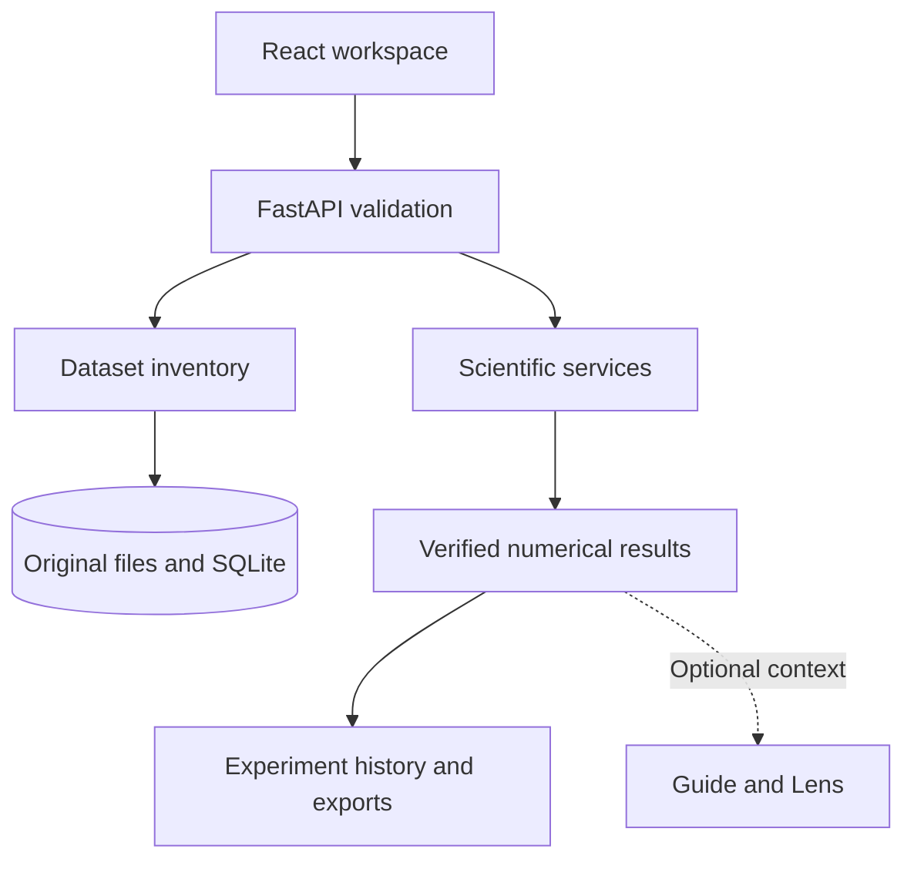

<div align="center">


# AXIOM LAB

**Computational discovery, with evidence**

 [](https://github.com/EthicalMaster/AXIOM-LAB/actions/workflows/ci.yml) [](https://github.com/EthicalMaster/AXIOM-LAB/commits/main)

Python · FastAPI · React · TypeScript · SQLite · Docker

</div>

---

## Overview

A local-first scientific computing environment for structured data exploration, bounded mathematics, statistics, machine learning and reproducible experiments. Numerical results originate from implemented algorithms rather than AI-generated calculations.

## Capabilities

| Area | Details |
|---|---|
| **Data and statistics** | CSV/Excel ingestion, immutable original bytes, fingerprints, profiling, quality diagnostics, distributions and one-sample inference. |
| **Mathematics** | Safe expression evaluation, bounded polynomial calculus, real square matrices and numerical methods. |
| **Machine learning** | Train-only preprocessing, regression, classification, clustering and bounded model comparisons. |
| **Reproducibility** | Chart experiment history, version lineage, comparison, replay and evidence-based exports. |
| **Guide and Lens** | Optional contextual AI assistance; method selection and computed evidence remain independent. |

## Architecture



*Conceptual flow, not a screenshot, performance graph or proof of live integration.*

## Quick start and verification

Python 3.11+, Node 22.12+, Git.

```powershell
git clone https://github.com/EthicalMaster/AXIOM-LAB.git
cd AXIOM-LAB
py -3 -m venv .venv
.\.venv\Scripts\python.exe -m pip install -e ".\backend[dev]"
.\.venv\Scripts\python.exe scripts/start_backend.py
```
In a separate terminal from the root:

```powershell
cd frontend
npm ci
npm run dev
```
Open <http://127.0.0.1:5173>; backend health: <http://127.0.0.1:8898/api/v1/health>. Run `pytest backend/tests -q` with the venv, then frontend `npm run test`, `npm run typecheck` and `npm run build`. Follow the release gate before any hosted deployment.

## Repository map

| Path | Responsibility |
|---|---|
| `frontend/src/` | React panels and typed API clients |
| `backend/app/api/` | FastAPI routes and validation |
| `backend/app/services/` | Statistics, math, ML and guidance |
| `backend/app/persistence/` | Metadata and local original-file storage |
| `backend/tests/` | Numerical, negative and integration tests |
| `docs/` | ADRs, scientific validation, release gates |

## Boundaries and release notes

- Single-user local-first candidate; no verified public multi-tenant authorization or large-scale capacity.
- Bounded methods: Shapiro–Wilk 3–5000 samples, polynomial degree ≤6, real square matrices 1–8, ML numeric feature workflows with bounded datasets. Consult scientific validation for assumptions.
- Optional AI is advisory. Keep private data and credentials outside Git.

## Documentation

- [Scientific validation](docs/SCIENTIFIC_VALIDATION.md)
- [Architecture](docs/ARCHITECTURE.md)
- [Release assurance](docs/RELEASE_ASSURANCE.md)
- [Release gates](docs/RELEASE_GATE.md)
- [Deployment](docs/DEPLOYMENT.md)
- [Contribution guide](CONTRIBUTING.md)
- [Changelog](CHANGELOG.md)

## Repository activity

[Commit history](https://github.com/EthicalMaster/AXIOM-LAB/commits/main) · [Pulse / activity graph](https://github.com/EthicalMaster/AXIOM-LAB/pulse) · [Issues](https://github.com/EthicalMaster/AXIOM-LAB/issues)

## License

No root license file was visible in the reviewed tree. Do not assume unrestricted redistribution. Third-party components retain their own terms.

<details>
<summary>Previous README and documentation provenance</summary>

[Original README at the reviewed revision](https://github.com/EthicalMaster/AXIOM-LAB/blob/7a1a3d5d96e6faba6520e3584228904663a5c84a/README.md). The previous file remains in Git history, including detailed historical commands and release notes. This overview reflects the inspected default branch, not unpublished local work.

</details>

---

<div align="center"><sub>ETHICALMASTER · DOCUMENTATION SERIES / 07</sub></div>
